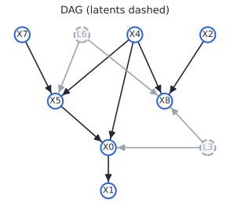
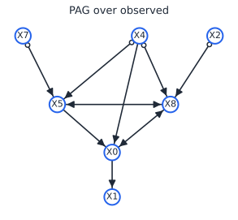

::: {.callout .result title="Result"}
The graph core of ETIA-JAX agrees with Tetrad on all 60 reference graphs for d-separation, the CPDAG and the MAG. For the PAG, it differs from Tetrad on 13 graphs. An exact search shows that each difference is a Tetrad error.
:::

::: stats
- 60 / 60 | CPDAG and MAG same as Tetrad | 2400 d-separation queries also same
- 32 | Tetrad PAG marks proved wrong | 29 tails, 3 missed arrowheads
- 0.028 | Largest weight error | OLS on 5000 GenJAX samples
- 17 | Tests pass | 16 fast (25 s) + 1 slow (6.5 min)
:::

## What increment 1 contains

| Module | Content |
|---|---|
| `etia_jax/graphs/encoding.py` | The ETIA/Tetrad mark matrix: `G[i, j]` is the mark at `j` (0 none, 1 circle, 2 arrowhead, 3 tail). |
| `etia_jax/graphs/dag.py` | Random DAGs, topological order, ancestors. |
| `etia_jax/graphs/separation.py` | d-separation (Bayes ball) and `DSepOracle`, the oracle CI test for later increments. |
| `etia_jax/graphs/orientation.py` | Meek rules R1–R4, and FCI rules R1–R4 and R8–R10 (Zhang 2008). |
| `etia_jax/graphs/convert.py` | `dag_to_cpdag`, `dag_to_mag` (latent variables), `mag_to_pag`, `dag_to_pag`. |
| `etia_jax/data/scm.py` | GenJAX structural causal models: linear, nonlinear, discrete and mixed. |
| `reference/make_fixtures.py` | Runs Tetrad in the old ETIA venv and saves the reference answers. |
| `tests/bruteforce.py` | Exact PAG reference: a search over all the MAGs in the equivalence class. |

## One model, from the DAG to the PAG

The model is a random DAG with 9 nodes (seed 90). Two nodes, `L3` and `L6`, are latent. A MAG keeps only the observed nodes, and a bidirected edge (`<->`) replaces each confounder. The PAG shows what all the MAGs in the equivalence class have in common. A circle (`o`) is a mark that is not the same in all of them.

::: {.figures cols=2}




:::

## GenJAX data from the same model

`make_scm(spec)` returns a GenJAX `@gen` function. Each node is one traced random choice (`x0` … `x8`), so the trace keeps the full joint sample, including the latent nodes. The model has random weights, with $|w| \in [0.5, 2]$ and a random sign, and Gaussian noise with $\sigma \in [0.5, 1.5]$.

::: {.chart src="weights.csv" type="scatter" x="true_weight" y="ols_estimate" x-label="True structural weight" y-label="OLS estimate from 5000 samples"}
**Figure 1.** Each point is one edge of the DAG. OLS of each node on its parents recovers the weight: the points are on the diagonal, and the largest error is 0.028.
:::

::: {.chart src="ci_queries.csv" type="scatter" x="abs_partial_corr" y="neg_log10_p" color="truth" x-label="|partial correlation|" y-label="−log10 p (Fisher z, capped at 50)"}
**Figure 2.** 250 random CI queries on the observed data, colored by the d-separation truth in the DAG. At α = 0.01, no d-separated query is rejected, and 97 % of the d-connected queries are rejected. Thus the sampler gives data that agrees with the graph. (This Fisher z test is a NumPy check. The JAX CI tests come in increment 2.)
:::

::::: {.toggle title="The first 400 samples (observed nodes)"}
::: {.table src="samples.csv" dec="X0:3 X1:3 X2:3 X4:3 X5:3 X7:3 X8:3" height=300}
**Table 1.** GenJAX samples of the observed nodes. The latent columns are not shown.
:::
:::::

## Comparison with Tetrad

`reference/make_fixtures.py` makes 60 random DAGs (5–12 nodes, about 20 % latent nodes). Then it saves the Tetrad answers for d-separation, `dagToCpdag`, `dagToMag` and `DagToPag`.

::: {.table src="tetrad_comparison.csv" labels="pag_shd_to_tetrad: PAG SHD to Tetrad | tetrad_wrong_tails: Tetrad wrong tails | tetrad_missed_arrows: Tetrad missed arrowheads" sort="pag_shd_to_tetrad:desc" height=360}
**Table 2.** One row per reference graph. The CPDAG and the MAG are the same as in Tetrad for all graphs. The PAG differs on 13 graphs. For each difference, the last two columns count the type.
:::

### Example: graph 55

Tetrad puts a tail at `X2` and `X4` on the edges into `X3`. A tail means "`X2` is an ancestor of `X3` in every MAG of the class". The witness MAG (c) has the same m-separations as the true MAG, and in it, `X2 <-> X3` and `X2 <-> X7`. Thus `X2` is not an ancestor of `X3`, and the circle of ETIA-JAX is correct.

::: {.figures cols=3}


:::

::: {.toggle title="How the test proves each difference"}
- **Tetrad tail, ETIA-JAX circle (29 marks).** The test searches for a MAG with these properties: it agrees with the PAG, it is ancestral, it has the same m-separations as the true MAG, and the tail node is not an ancestor there. One such MAG proves that the tail is wrong.
- **Tetrad circle, ETIA-JAX arrowhead (3 marks).** The test makes that mark free and examines every MAG that agrees with the rest of the PAG. All equivalent MAGs have an arrowhead there, so the arrowhead is invariant.
- Both checks are in `test_pag_exact_where_tetrad_differs` (`pytest -m slow`).
:::

## Tests

::: {.table src="tests.csv" best="time_s:min" height=420}
**Table 3.** The test suite. Run `pytest -q` for the fast tests, and `pytest -m slow` for the exact Tetrad check.
:::

## Next: increment 2

Increment 2 adds the CI tests in JAX: FisherZ, ParCorr (robust and weighted), G², χ², the conditional Gaussian and discrete LRTs, RegressionCI, CMIknn, CMIsymb, GPDC and CCI. Each test must have uniform p-values under the null, enough power, and agreement with the tigramite and Tetrad fixtures.

::: {.toggle title="How to remake this page"}
```bash
cd ~/PROJECTS/ETIA-JAX
.venv/bin/python demo/increment1/make_data.py
pageview demo/increment1/increment1.md
```
:::
